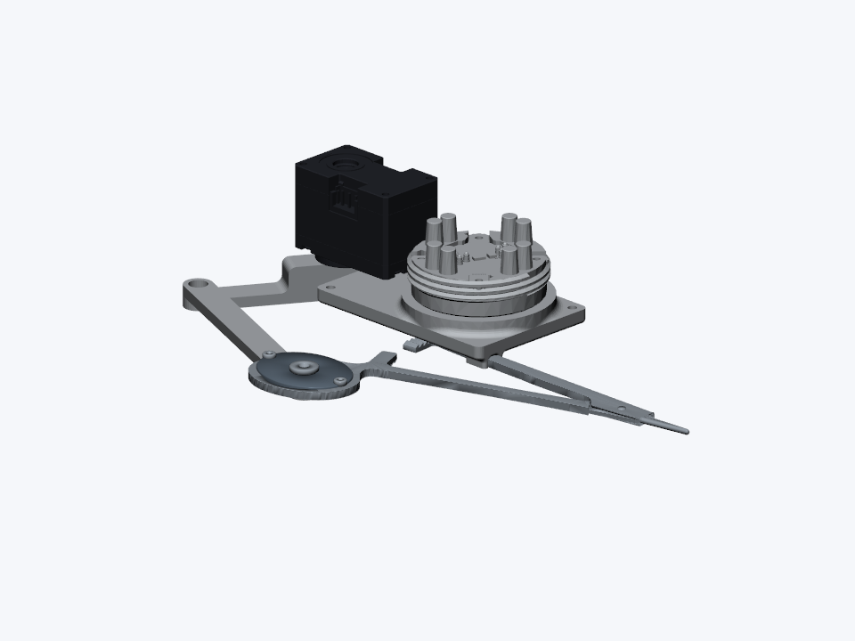
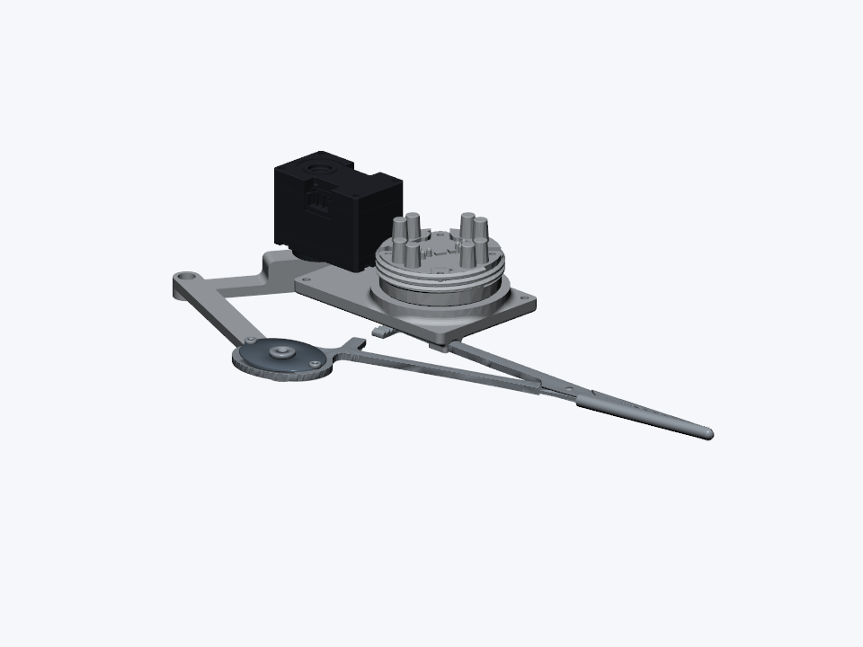

# detachable_tools

Detachable surgical tools (gripper, needle holder, forceps) driven by Dynamixel motors, for ROS 1 and ROS 2.

The left/right needle-holder descriptions and the standalone holder now share the
SimReady-derived metal jaws and slotted ring-to-link adapter used in `surgenoid_sim`.
The threaded mount, motor/linkage joints, inertias and controller calibration are
retained. The adapter is a visual model; no new physical constraint is introduced.
Meshes are in metres under `meshes/simready_holder`, with NVIDIA attribution,
CC-BY-4.0 license, adapter design metadata and source/export hashes. The donor is
an artery-forceps asset adapted to the original holder, not a dedicated clinical
needle-holder model. OBJ/MTL provides the visuals and STL the jaw collision mesh.

To resync from a `surgenoid_sim` checkout:

```bash
.venv/bin/python -m surgeon_sim.tools.export_detachable_holder --package /path/to/detachable_tools
```

The `pean` tool (alias `hemostat`) uses the same detachable screw, drive linkage,
and ring adapter as the holder, with longer SimReady metal jaws: approximately
52 mm from pivot to tip. Both hands include a dedicated URDF, tip frame, open/close
states, and loop couplings. ROS 2 uses `mock_components/GenericSystem` for this
new tool; it has no assigned physical motor IDs or hardware calibration.

```bash
# Model display only
ros2 launch detachable_tools hand_model.launch.xml side:=rhand tool:=pean

# From the surgenoid_sim checkout, after exporting the shared holder assets
.venv/bin/python -m surgeon_sim.tools.export_detachable_pean --package /path/to/detachable_tools
```

In Surgenoid Sim, select `--right-tool pean` or `--left-tool pean`. The left-leg
LVA demo uses the right-arm joints and the mounted jaw contact sites to drive
local tissue exploration, with a swept nerve-distance guard.

| Tool | Hardware | Model |
| --- | --- | --- |
| `gripper` |  |  |
| `needle_holder` |  |  |
| `pean` | Simulation model |  |

## Setup

```bash
# ROS 1
cd <catkin workspace>
vcs import src < src/jsk-ros-pkg/jsk_robot/jsk_hand/detachable_tools/ros1.yaml
rosdep install -iry --from-paths src
catkin build detachable_tools

# ROS 2
cd <colcon workspace>
vcs import src < src/jsk-ros-pkg/jsk_robot/jsk_hand/detachable_tools/ros2.yaml
rosdep install -iry --from-paths src
colcon build --packages-up-to detachable_tools
```

To use `/dev/lhand` and `/dev/rhand`:

```bash
sudo scripts/create_udev_rules.sh
sudo udevadm control --reload-rules && sudo udevadm trigger
```

| Motor | Left ID | Right ID |
| --- | ---: | ---: |
| Detacher | 0 | 1 |
| Gripper (`gripper`, `generic`) | 2 | 3 |
| Needle holder (`needle_holder`) | 4 | 5 |
| Forceps (`forceps`) | 6 | 7 |
| YUBI (`yubi`) | 8 | 9 |

YUBI setup, source CAD, and model limitations: [YUBI](meshes/yubi/README.md).

## Usage

Start the hands (the launch files and arguments are the same on ROS 1, `roslaunch ... <name>.launch`):

```bash
ros2 launch detachable_tools hand_control.launch.xml side:=lhand tool:=gripper
ros2 launch detachable_tools dual_hand.launch.xml left_tool:=gripper right_tool:=needle_holder
ros2 launch detachable_tools hand_detacher.launch.xml side:=lhand            # no tool attached
ros2 launch detachable_tools hand_model.launch.xml side:=rhand tool:=needle_holder  # model only
```

### Automatically detect attached tools (ROS 1 / ROS 2)

```bash
ros2 launch detachable_tools dual_hand_auto.launch.xml
# ROS 1
roslaunch detachable_tools dual_hand_auto.launch
```

Automatically detects tools on `/dev/lhand` and `/dev/rhand` at startup.
Stop existing hand launches first. Restart this launch to detect tools again,
or use `set_tool/<tool>` to select a tool at runtime.

- For tool-only hardware, set `include_detacher:=false` (default: `true`).
  If only a tool responds, that side starts with the detacher disabled.
- To change serial settings, use `left_port_name`, `right_port_name`, and `baud_rate`.

### Inspect detected and selected tools

Startup console logs show the arm (`lhand`/left or `rhand`/right), serial port,
responding IDs, tool type, and whether a tool was detected.
Both ROS versions publish `diagnostic_msgs/DiagnosticArray` on:

| Topic (replace `lhand` with `rhand` for the right arm) | Contents |
| --- | --- |
| `/lhand/detected_tool` | Startup scan: side, port, detected IDs, tool, attached, `detection_scope=startup`. Auto launch only. |
| `/lhand/tool_state` | Selected model: side, tool, attached, motor IDs; updated on tool changes. |
| `/lhand/hand_description` | Selected model and individual motor specifications. |

Detection is a startup snapshot, not a live connection or controller-health
monitor. `tool_state` describes the selected model, not proof of successful
motor communication. Check controller_manager for controller/hardware status.
ROS 1 publishers are latched; ROS 2 publishers use reliable transient-local QoS
so late subscribers can retrieve the last message:

```bash
ros2 topic echo /lhand/detected_tool --qos-durability transient_local --qos-reliability reliable --once
ros2 topic echo /rhand/tool_state --qos-durability transient_local --qos-reliability reliable --once
# ROS 1
rostopic echo -n 1 /lhand/detected_tool
rostopic echo -n 1 /rhand/tool_state
```

### Python

```python
from hand_controller import LHandController, RHandController

lhand = LHandController()
lhand.detach()                 # release the tool
lhand.attach()                 # lock the tool
lhand.open()                   # gripper
lhand.close(effort=0.5)        # effort: grasp current [Nm]
lhand.open_holder()            # needle holder
lhand.close_holder()
lhand.open_forceps()           # forceps (also open_scissors / close_scissors)
lhand.close_forceps()
lhand.move_named("open", "needle_holder")  # any <group_state> of srdf/<side>.srdf
```

The open / close positions are the `<group_state>`s of `srdf/lhand.srdf` and `srdf/rhand.srdf`.

Switch the tool without restarting the launch (`generic`, `gripper`, `needle_holder`, `forceps`, `detacher`):

```bash
ros2 service call /lhand/set_tool/needle_holder std_srvs/srv/Trigger
ros2 service call /lhand/get_tool_state std_srvs/srv/Trigger
```

From the command line:

```bash
ros2 run detachable_tools hand_command.py --side lhand close
ros2 run detachable_tools hand_command.py --side lhand detach
```

### EusLisp

The same operations are available from EusLisp:

```lisp
(load "package://detachable_tools/euslisp/all.l")
(lhand-init)
(send *lhand* :close)
(send *lhand* :open-holder)
(send *lhand* :move-named "open" :tool "needle_holder")
(send *lhand* :detach :tm 1.0)
```

`euslisp/tool-change.l` switches the robot model, the IK target and the running hand together:

```lisp
(tool-setup-robot *nextage* :robot-kind :nextage)
(attach-tool *nextage* :rarm :needle-holder :physical t :restart-control t)
(tool-ik *nextage* :rarm target-coords :rotation-axis t)
(detach-tool *nextage* :rarm :physical t :restart-control t)
```

## Add new end-effectors

For a tool named `<tool>` (on both `lhand` and `rhand`):

1. Meshes: put them in `meshes/<tool>/` and refer to them as
   `package://detachable_tools/meshes/<tool>/<file>`.
2. URDF: add `urdf/<side>_<tool>.urdf`, starting from `urdf/<side>_generic.urdf`.
   - The root link is `<side>_base_link` and every name starts with `<side>_`.
   - `<side>_joint` is the tool motor (motor angle in rad, `revolute` with limits wider than
     the SRDF positions), with its `<transmission>` (actuator `<side>_motor`).
   - `<ros2_control name="<side>_<tool>">` has the motor `ID` (unique on the bus) and
     `Operating Mode` (5: current-based position) in `<gpio name="<side>_motor">`;
     rename the `generic/...` service names to `<tool>/...`.
3. SRDF: in `srdf/<side>.srdf`, add `<group name="<side>_<tool>">` with `<side>_joint`
   and its `<group_state>`s (at least `open` and `close`, motor angle in rad).
4. Joints that only follow the motor for display (fingers, linkages): add
   `config/<side>/<tool>_loop_couplings.yaml` (polynomial of `<side>_joint`).
5. ROS 2: in `config/<side>/controllers.yaml`, add `<side>_<tool>` to
   `hardware_components_initial_state.unconfigured` and a `<tool>_gripper_controller`
   (copy an existing one, joint `<side>_<tool>_joint`).

Then `set_tool/<tool>` and `move_named("open", "<tool>")` work for the new tool.

### Fork simulation (ROS 2 Jazzy)

Run in an environment where `nextage_tutorials` and `nextage_description` have been built.

```bash
sudo apt install ros-jazzy-apriltag-ros python3-scipy python3-opencv
colcon build --packages-select detachable_tools
source install/setup.bash
ros2 run detachable_tools apriltag_fork_sim.py
```

- `--config FILE`: Use a custom configuration (default: `config/fork_simulation.yaml`)
- `--no-rviz --once`: Run once without a GUI
- `--output DIR`: Directory for logs (default: `/tmp/apriltag_fork_sim/`)

### Example for Nextage fork (ROS 2)

Build `nextage_tutorials` and publish joint states, camera TFs, and detected AprilTag TFs before calling the services from a pose where the tag is visible.

```bash
ros2 run detachable_tools nextage_fork_server.py \
  --config "$(ros2 pkg prefix detachable_tools)/share/detachable_tools/config/nextage_fork_api.yaml"
```

Services use `std_srvs/Trigger` under `/fork_exchange/`, with JSON in the response `message` field.

- `plan_detach` / `plan_attach`: Check the planned paths
- `detach` / `attach`: Detach / attach the fork

Python:

```python
import rclpy
from detachable_tools_common.fork_api import NextageForkAPI

rclpy.init()
node = rclpy.create_node('fork_client')
fork = NextageForkAPI(node)
future = fork.plan_detach()  # The same applies to plan_attach(), detach(), and attach()
rclpy.spin_until_future_complete(node, future)
print(fork.result(future.result()))
node.destroy_node()
rclpy.shutdown()
```

EusLisp:

```lisp
(load "package://detachable_tools/euslisp/fork-exchange.l")
(nextage-fork-plan-detach)
(nextage-fork-plan-attach)
(nextage-fork-detach)
(nextage-fork-attach)
```

For real hardware, copy the configuration file and adjust the tag and tool transforms, camera TFs, observation poses, insertion direction, detach/attach currents and durations, and controller names to match your robot. Set `calibrated: true` and launch with `--hardware`.

## Tool force telemetry (ROS 1 / ROS 2)

`hand_control.launch` / `hand_control.launch.xml` starts `tool_force_publisher.py` by default (`publish_tool_force:=true`). It observes the selected tool's raw `joint_states` and `tool_state`; it never sends motor commands. The same portable estimator and tool profiles are exported from `surgenoid_sim/surgeon_sim/sensors`, with hashes in `config/tool_force/sync.json`. There is no dependency on any particular demo, tissue, wound, or motion schedule. A profile is currently supplied for the Pean; unsupported tools publish an invalid status.

Default topics in each hand namespace:

| Topic | Type | Meaning |
| --- | --- | --- |
| `joint_states` | `sensor_msgs/JointState` | Input drive position [rad], velocity [rad/s], output-shaft effort [N m]. Missing effort stays unavailable. |
| `tool_state` | `diagnostic_msgs/DiagnosticArray` | Active tool, attachment, command joint and tool root frame from the manager. |
| `tool_gravity` | `geometry_msgs/Vector3Stamped` | Optional fresh gravity acceleration [m/s²], already expressed in the active tool root frame. |
| `tool_force` | `sensor_msgs/JointState` | Virtual prismatic opening coordinate: gap [m], gap speed [m/s], signed opening force [N]. |
| `tool_force/status` | `diagnostic_msgs/DiagnosticArray` | Shared telemetry fields, input provenance, validity and calibration/compensation flags. |

For example, the right-hand output is `/rhand/tool_force`. Its `effort` is a **force in N**, because this represents a virtual prismatic coordinate, not the drive revolute joint. `force_n` is conjugate to the jaw gap: `F = (tau - compensation) / (dg/dq)`. Equal and opposite forces act at the two jaws; this is the magnitude per jaw with opening-positive sign, not a doubled force or a 6-axis wrench. Closing load can be negative. `opening_force_n` in diagnostics is its positive part for opening-force plots. No contact-truth gate hides noise or empty-motion residuals.

Diagnostics encode the shared fields as JSON values: `stamp_s`, `tool`, `side`, `current_a`, `effort_nm`, `position_rad`, `gap_m`, `jacobian_m_per_rad`, `compensation_nm`, `force_n`, `opening_force_n`, `valid`, `reason`, `source`, `calibrated`, `compensation_complete`. The additional `input_unit` value is plain text. Force is null in diagnostics / NaN in `JointState` when unavailable, stale (default 0.25 s), detached, out of profile range, current-saturated, or at a singular transmission. A tool change resets derivative history. `display_joint_states` is deliberately not an input: the display relay can fill absent efforts with zero.

The default `tool_force_input_unit:=torque_nm` accepts already converted output-shaft torque and does not apply Kt again. Only if a backend explicitly puts current into the effort field, select `current_a` or `current_ma`. The conversion is `tau = Kt * (I - bias)`; the profile's Kt is after the motor's internal gearbox. Do not multiply the gearbox reduction twice. Motor families reporting load rather than measured current require a separately validated backend conversion.

Friction, reflected inertia and CAD gravity compensation are tool properties in `config/tool_force/pean.json`. Full compensation requires fresh `tool_gravity` in the correct frame and consecutive velocity samples. Otherwise `compensation_complete=false`; numeric partial estimates carry WARN. `--profile-dir`, `--input-topic`, `--output-topic`, `--timeout-s` are available when running the node directly. Keep measured calibration profiles outside generated assets, as re-export overwrites generated defaults.

The supplied Pean ROS control model uses `mock_components/GenericSystem`. Those readings are labelled `mock_joint_effort` (or `mock_joint_current`), never hardware measurements. Recognized Dynamixel plugins are labelled `hardware_joint_effort`; unspecified backends, including ones whose URDF lacks ROS 2 hardware metadata, remain `unverified_joint_effort`. The current profile is **uncalibrated**: constants, friction and masses need real measurements before interpreting estimates as actual tissue force. These flags are retained in telemetry. No motor IDs were invented or enabled by this telemetry feature.

ROS 2 build/install and isolated transport are checked. The transport test covers effort-to-force conversion, mock provenance, absent effort, detachment, and timeout, with no motor commands:

```bash
source /opt/ros/jazzy/setup.bash
source /path/to/colcon_ws/install/setup.bash
ROS_DOMAIN_ID=117 ROS_AUTOMATIC_DISCOVERY_RANGE=LOCALHOST \
  python3 test/test_tool_force_ros2.py
```

This does not validate physical force accuracy. Hardware measurements and the ROS 1 live transport remain to be verified.

### Six-axis wrist sensor interface

`hand_control` also starts `wrist_wrench_publisher.py` (`publish_wrist_wrench:=true`). This separate observation interface is independent of the tool-opening estimator and does not turn a scalar jaw force into a six-axis wrench. Each hand reads `wrench_raw` and publishes `wrist_wrench`, both `geometry_msgs/WrenchStamped`, plus `wrist_wrench/status` diagnostics. Forces use N and moments use N m. Default full topics are `/lhand/wrist_wrench` and `/rhand/wrist_wrench`.

Set `wrist_wrench_input` to the actual sensor driver's topic and `wrist_sensor_config` to a copy of `config/wrist_sensors.json`. This configuration specifies input/output frames, input provenance, calibrated flag, six-axis bias, sign and the fixed transform from input to output frame. Translation is the input origin in output coordinates; the transform applies `F_out = R F_in`, `T_out = R T_in + translation × F_out`. Canonical sign is the support wrench exerted by the arm on its distal assembly. Raw readings include gravity and inertia. The default configuration is uncalibrated and does not claim that a physical sensor has been connected. Frame mismatch, missing input, nonfinite data and stale timestamps produce invalid status and six NaNs, never fictitious zero load.

The portable `wrench_telemetry.py` and sensor configuration are shared with Surgenoid Sim through the existing export command and `config/tool_force/sync.json`. The simulator registers sensors at the existing NEXTAGE wrist sensor frames in every scene; ordinary dynamics and kinematic reconstruction retain distinct `source` values. A sensor remains meaningful when a tool is detached, so its lifecycle is independent of the tool force stream.

Run the node directly with `--log-jsonl /path/to/wrist.jsonl` to record the shared sensor contract: `kind=wrist_wrench`, `side`, `stamp_s`, `frame_id`, `force_n[3]`, `torque_nm[3]`, `valid`, `reason`, `source`, `calibrated`, `gravity_compensated`, `convention`. Each sensor sample is one JSON line. Surgenoid Sim's common plotter accepts this through `--wrist-telemetry` and an explicit `--wrist-time-offset`; it does not guess clock alignment or bridge stale samples.

The isolated ROS 2 test `test/test_wrist_wrench_ros2.py` verifies both hands, all six values, provenance, frame rejection and timeout through actual pub/sub. Sensor force accuracy and the physical driver's frame/sign calibration remain unverified.
